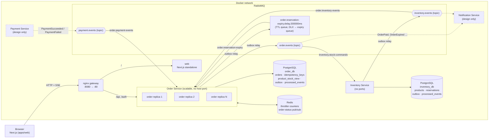

# ARCHITECTURE.md — Flash Sale

این سند تصمیم‌های نهایی معماری را همان‌طور که در کد پیاده شده‌اند توضیح می‌دهد. مسیر فایل‌ها نسبت به ریشه‌ی ریپو است.

خلاصه: دو سرویس مستقل NestJS (`order` و `inventory`) هر کدام با PostgreSQL خودش، ارتباط فقط از طریق RabbitMQ، Transactional Outbox در هر دو سرویس، Redis برای Rate Limit مشترک و fan-out رویدادهای SSE، و nginx جلوی Replicaهای Order.

---

## ۱. دیاگرام کلی سیستم



### جریان خرید

```mermaid
sequenceDiagram
  autonumber
  participant B as Browser
  participant O as Order (any replica)
  participant ODB as order_db
  participant MQ as RabbitMQ
  participant I as Inventory
  participant IDB as inventory_db
  participant R as Redis

  B->>O: POST /api/orders (Idempotency-Key, JWT)
  O->>ODB: BEGIN; claim (user, key); check product_stock_view;<br/>INSERT order Pending v1; INSERT outbox StockReservationRequested; COMMIT
  O-->>B: 201 {orderId, Pending, 1}
  B->>O: GET /api/orders/:id/events?token=…
  O-->>B: data {Pending, 1}
  O->>MQ: outbox relay (FOR UPDATE SKIP LOCKED, publisher confirm)
  MQ->>I: StockReservationRequested
  I->>IDB: BEGIN; claim eventId; SELECT product FOR UPDATE;<br/>stock-1, reserved+1; INSERT reservation; INSERT outbox StockReserved; COMMIT
  I->>MQ: outbox relay → StockReserved
  MQ->>O: StockReserved (any replica consumes)
  O->>ODB: BEGIN; claim eventId; update read model;<br/>UPDATE orders … WHERE status='Pending' → Reserved v2; outbox expiry; COMMIT
  O->>R: PUBLISH order-status:{id} {Reserved, 2}
  R-->>O: every replica receives it
  O-->>B: data {Reserved, 2} (from the replica holding the SSE connection)
```

### سرویس‌ها و مرز داده

| سرویس | مالک داده | ورودی | خروجی |
|---|---|---|---|
| Order (`apps/api/src/order`) | `orders`، `idempotency_keys`، `product_stock_view` (read model)، `outbox_events`، `processed_events` در `order_db` | HTTP عمومی، `order.inventory-events`، `order.reservation-expiry`، `order.payment-events` | `order.events`، صف تأخیری expiry، Redis pub/sub |
| Inventory (`apps/api/src/inventory`) | `products`، `reservations`، `outbox_events`، `processed_events` در `inventory_db` | `inventory.stock-commands` | `inventory.events` |
| Payment (فقط طراحی) | تراکنش‌های پرداخت | `order.events` (رزرو شد) | `payment.events` |
| Notification (فقط طراحی) | ترجیحات اعلان | `order.events`، `inventory.events` | ایمیل/پوش |

Order و Inventory هیچ‌وقت با HTTP همدیگر را صدا نمی‌زنند. Order برای `GET /api/products/:id` و تصمیم `SOLD_OUT` از read model محلی خودش استفاده می‌کند که با رویدادهای Inventory به‌روز می‌شود (`apps/api/src/order/modules/products/repository/product-stock.repository.ts:21`).

کد مشترک در `apps/api/src/common` فقط زیرساخت است: auth، throttling، اتصال RabbitMQ، Outbox، Inbox، قرارداد پیام‌ها و health. منطق دامنه داخل هر سرویس است.

---

## ۲. جلوگیری از Dual-Write: Transactional Outbox

مشکل: اگر سرویس اول در دیتابیس بنویسد و بعد به Broker پیام بفرستد، crash بین این دو باعث می‌شود تغییر ثبت شود ولی پیام هرگز نرود (یا برعکس).

راه‌حل در هر دو سرویس یکسان است:

1. **نوشتن در همان تراکنش.** هر تغییر دامنه و رویداد خروجی‌اش در یک تراکنش PostgreSQL ثبت می‌شوند: `appendToOutbox` در `apps/api/src/common/messaging/outbox/outbox.writer.ts:5` در همان `EntityManager` تراکنش ردیف `outbox_events` را insert می‌کند. نمونه‌ها: ثبت سفارش در `apps/api/src/order/modules/orders/service/order-placement.service.ts`، رزرو در `apps/api/src/inventory/modules/stock/service/stock-reservation.service.ts`.
2. **Relay جدا.** `OutboxRelay` (`apps/api/src/common/messaging/outbox/outbox.relay.ts:42`) در هر Replica هر `OUTBOX_POLL_INTERVAL_MS` ردیف‌های منتشرنشده را با `SELECT … FOR UPDATE SKIP LOCKED` برمی‌دارد (`outbox.relay.ts:49-50`)، روی **confirm channel** منتشر می‌کند و فقط بعد از ack بروکر `published_at` را می‌زند. Replicaهای دیگر ردیف‌های قفل‌شده را رد می‌کنند، پس یک batch دو بار منتشر نمی‌شود. اگر انتشار شکست بخورد ردیف می‌ماند، `attempts` و `last_error` به‌روز می‌شوند و poll بعدی دوباره تلاش می‌کند.
3. **مصرف‌کننده‌ی idempotent.** Outbox تضمین at-least-once می‌دهد (مثلاً crash بعد از publish و قبل از commit علامت published). هر consumer در همان تراکنش اثر جانبی، `eventId` را در `processed_events` با `INSERT … ON CONFLICT DO NOTHING` claim می‌کند (`apps/api/src/common/messaging/inbox/claim-event.ts:11`). تکرار پیام هیچ تغییری ایجاد نمی‌کند.
4. **Fan-out بعد از commit.** انتشار وضعیت به Redis برای SSE بعد از commit انجام می‌شود و جزو منبع حقیقت نیست؛ اگر از دست برود، کلاینت هنگام reconnect وضعیت را از `GET /api/orders/:id` دوباره می‌خواند.

تست اثبات: `apps/api/test/outbox-recovery.e2e-spec.ts` (ثبت سفارش با publisher خراب، kill کردن Replica، بالا آمدن Replica جدید، انتشار و رزرو؛ و سه relay رقیب که ۶۰ ردیف را دقیقاً یک‌بار منتشر می‌کنند).

---

## ۳. مقیاس‌پذیری افقی، گلوگاه دیتابیس و محل دقیق قفل

### محل قفل

**`apps/api/src/inventory/modules/stock/repository/stock.repository.ts:24`**

```ts
.setLock('pessimistic_write')
```

این خط در `StockRepository.lockProduct` (همان فایل، خط ۱۷) کوئری `SELECT … FROM products WHERE id = $1 FOR UPDATE` را می‌سازد. هر سه عملیات رزرو، آزادسازی و commit اول این قفل را می‌گیرند (`apps/api/src/inventory/modules/stock/service/stock-reservation.service.ts:66`، `:113` و `:149`) و بعد در همان تراکنش موجودی، رزرو و Outbox را می‌نویسند.

### چرا بین چند instance هم درست است

- قفل روی **ردیف PostgreSQL** است، نه در حافظه‌ی process. همه‌ی Replicaهای Inventory به یک `inventory_db` وصل‌اند، پس رزروهای هم‌زمان برای یک محصول در دیتابیس سریالی می‌شوند؛ هیچ قفل in-memory وجود ندارد.
- خواندن `stock` و نوشتن مقدار جدید در یک تراکنش و زیر همان قفل انجام می‌شود، پس race بین check و update ممکن نیست.
- خط دفاعی دوم در خود جدول است: `CHECK (stock >= 0)` و `CHECK (stock + reserved + sold = initial_stock)` (`apps/api/src/inventory/modules/stock/entities/product.entity.ts:10-16`). حتی با کد اشتباه هم دیتابیس overselling را رد می‌کند.
- `UNIQUE (order_id)` روی `reservations` تضمین می‌کند یک سفارش دو بار رزرو نشود، حتی با `eventId` متفاوت.
- در Order، تغییر وضعیت یک `UPDATE … WHERE status = ANY(allowed) RETURNING` اتمیک است (`apps/api/src/order/modules/orders/repository/orders.repository.ts:51`)؛ رویداد قدیمی یا تکراری هیچ ردیفی را تغییر نمی‌دهد و `version` فقط یک‌بار زیاد می‌شود. یکتایی `Idempotency-Key` هم با کلید اصلی `(user_id, idempotency_key)` و `INSERT … ON CONFLICT DO NOTHING` تضمین می‌شود (`apps/api/src/order/modules/orders/repository/idempotency-keys.repository.ts:22`)، نه با حافظه.

### Stateless بودن

هیچ وضعیت کسب‌وکاری در حافظه‌ی Replica نیست: Rate limit در Redis، idempotency و وضعیت سفارش در PostgreSQL، fan-out SSE از Redis pub/sub. `docker compose up --scale order=3` بدون تغییر کار می‌کند؛ nginx با `resolve` ردیف‌های جدید DNS را به upstream اضافه می‌کند. Migrationها هنگام بالا آمدن با `pg_advisory_lock` اجرا می‌شوند تا Replicaهای هم‌زمان با هم تداخل نکنند (`apps/api/src/common/database/run-migrations-with-lock.ts`).

### گلوگاه دیتابیس و کاهش آن

- **Hot row.** همه‌ی رزروها روی یک ردیف قفل می‌گیرند؛ این عمداً گلوگاه درستی است. هر تراکنش رزرو کوتاه است (چند کوئری روی index اصلی)، و Inventory با prefetch محدود (`20`) مصرف می‌کند تا pool اتصال (`20`، `connectionTimeoutMillis: 5000`) پر نشود.
- **فیلتر جلوی Inventory.** ۵۰ هزار درخواست به Inventory نمی‌رسد: Rate limit (۱۰/ثانیه برای هر IP، ۵/ثانیه برای هر کاربر) و پاسخ `SOLD_OUT` از read model محلی Order بعد از تمام شدن موجودی، بار را قبل از دیتابیس Inventory قطع می‌کنند. ردیف idempotency و سفارش در `order_db` هم با indexهای اصلی و یک تراکنش کوتاه نوشته می‌شوند.
- **Partial index** روی `outbox_events(occurred_at) WHERE published_at IS NULL` باعث می‌شود poll کردن relay با رشد جدول کند نشود.
- **Eventual consistency.** read model ممکن است چند صد میلی‌ثانیه عقب باشد؛ در آن پنجره سفارش‌های اضافه `Pending` ساخته می‌شوند و Inventory آن‌ها را رد می‌کند (`Cancelled`). درستی را Inventory تضمین می‌کند، read model فقط فیلتر است.

اندازه‌گیری: ۶۰۰ فرمان رزرو هم‌زمان روی دو Replica از Inventory در کمتر از ۵ ثانیه دقیقاً ۵۰۰ رزرو و ۱۰۰ رد ساختند؛ در Docker با سه Replica از Order، ۲۰۰ خریدار هم‌زمان برای ۹۹ واحد باقی‌مانده دقیقاً ۹۹ رزرو و ۱۰۱ لغو گرفتند و `Paid + Reserved = 500`، `stock = 0`.

---

## ۴. رویکرد امنیتی و تهدیدها

| تهدید (STRIDE) | کنترل | محل |
|---|---|---|
| Spoofing کاربر | JWT با HS256 و `algorithms: ['HS256']` پین‌شده (توکن `alg:none` یا با secret دیگر رد می‌شود)؛ Guard سراسری default-deny برای همه‌ی مسیرها جز `@Public()` | `apps/api/src/common/auth/jwt-auth.module.ts`، `jwt-auth.guard.ts` |
| Spoofing IP برای دور زدن Rate limit | nginx هدر `X-Forwarded-For` را با `$remote_addr` **بازنویسی** می‌کند و اپ فقط به یک hop اعتماد دارد | `docker/nginx/nginx.conf`، `create-http-service.ts` |
| نشت توکن SSE | `?token=` فقط روی مسیری که `@AllowQueryToken()` دارد پذیرفته می‌شود؛ لاگ اپ و لاگ nginx بدون query string ثبت می‌شوند | `request-logging.middleware.ts`، `nginx.conf` (`log_format without_query`) |
| Elevation / IDOR | سفارش فقط برای مالکش خوانده یا stream می‌شود؛ سفارش دیگران `404` می‌دهد تا وجودش هم افشا نشود | `order-placement.service.ts`، `order-status-feed.service.ts` |
| Tampering ورودی | `ValidationPipe` با `whitelist`، `forbidNonWhitelisted`، `transform`؛ `quantity` دقیقاً ۱؛ `Idempotency-Key` باید UUID v4 باشد؛ بدنه حداکثر 10KB | `validation-pipe.config.ts`، `create-order.dto.ts` |
| Denial of service | Throttler با storage در Redis (مشترک بین Replicaها)؛ صف‌ها با prefetch محدود؛ `client_max_body_size 16k` | `throttling.module.ts`، `scoped-throttler.guard.ts` |
| تکرار درخواست / پیام | Idempotency-Key به ازای کاربر با unique key و نگهداری ۲۴ ساعته؛ dedupe رویدادها با `eventId` | بخش ۳ |
| Information disclosure | Exception filter کد ماشینی برمی‌گرداند، هرگز stack trace؛ خطای زیرساخت `503`؛ `helmet`؛ حذف `x-powered-by` | `exception.filter.ts` |
| دسترسی مستقیم به Inventory | Inventory هیچ `ports` ندارد؛ Postgres، Redis و RabbitMQ هم در compose نهایی پورت host ندارند | `docker/compose.yml` |
| Secret | همه‌ی secretها از env؛ `.env` در git و در build context Docker نیست؛ کانتینرها با کاربر `node` اجرا می‌شوند | `.gitignore`، `.dockerignore`، Dockerfileها |
| پیام مخرب در صف | envelope هر پیام اعتبارسنجی می‌شود؛ پیام خراب بدون retry به DLQ می‌رود | `integration-event.ts`، `rabbitmq.consumer.ts` |

ریسک‌های پذیرفته‌شده:

- **Auth موک است:** هر نام کاربری پذیرفته می‌شود؛ این خواسته‌ی چالش است.
- **توکن در `sessionStorage`:** در برابر XSS آسیب‌پذیر است. دلیلش این است که قرارداد API توکن را در body برمی‌گرداند و `EventSource` نمی‌تواند header بفرستد. توکن در URL مسیر SSE هم ممکن است در history مرورگر بماند؛ عمر توکن یک ساعت است.
- **Fail-open:** اگر Redis قطع شود، Rate limiter با هشدار fail-open می‌شود. این انتخاب availability است، چون تضمین عدم overselling به Redis وابسته نیست.
- **Dev payment:** endpoint `POST /api/dev/orders/:id/payment` فقط با `ENABLE_DEV_PAYMENT=true` فعال است و باید در production خاموش بماند.

---

## ۵. چرا RabbitMQ و Delayed Delivery چطور کار می‌کند

**چرا RabbitMQ و نه Kafka:** کار ما صف فرمان و رویداد با routing بر اساس نوع است، نه log بلندمدت یا replay. RabbitMQ این‌ها را بدون سرویس اضافه می‌دهد: ack دستی، dead-letter، TTL برای تأخیر، publisher confirm، و competing consumers برای مقیاس افقی. برای یک Broker تک‌نود با زمان راه‌اندازی زیر دو دقیقه، راه‌اندازی و عملیات آن ساده‌تر از Kafka است. RabbitMQ به‌تنهایی exactly-once نمی‌دهد؛ تضمین‌ها از Outbox و Inbox می‌آیند.

**توپولوژی** (قراردادها در `apps/api/src/common/messaging/contracts/`):

- `order.events` (topic): فرمان‌های `stock.reservation-requested`، `stock.release-requested`، `stock.commit-requested` → صف `inventory.stock-commands`.
- `inventory.events` (topic): `stock.reserved`، `stock.reservation-rejected`، `stock.released`، `stock.committed`، `stock.snapshot-published` → صف `order.inventory-events`.
- `payment.events` (topic): `payment.succeeded`، `payment.failed` → صف `order.payment-events`.
- **فرمت پیام:** `{ eventId, aggregateId, version, occurredAt, type, payload }`. `eventId` یکتا است و پیام persistent است.
- هر سرویس صف‌هایی را هم که در آن‌ها publish می‌کند declare می‌کند (با تعریف مشترک و idempotent). در غیر این صورت پیامی که قبل از بالا آمدن مصرف‌کننده منتشر شود unroutable می‌شود و از بین می‌رود؛ این را در تست‌ها دیدیم و رفع شد.

**قابلیت اطمینان مصرف:**

- مصرف با ack دستی و prefetch محدود انجام می‌شود.
- خطای موقت: پیام با هدر `x-retry-count` به صف `<queue>.retry.<delay>ms` می‌رود که TTL دارد و با DLX به صف اصلی برمی‌گردد. ack پیام اصلی فقط بعد از confirm انتشار retry انجام می‌شود.
- بعد از `MESSAGE_MAX_RETRIES`، یا برای پیام خراب و نوع ناشناخته، پیام با `nack(requeue=false)` به `<queue>.dlq` می‌رود.

**Delayed delivery برای انقضای ۵ دقیقه‌ای (بدون plugin):**

1. وقتی سفارش `Reserved` می‌شود، در همان تراکنش یک پیام `ReservationExpiryScheduled` در Outbox ثبت می‌شود که مقصدش صف `order.reservation-expiry.delay.300000ms` است (`order-lifecycle.service.ts`، `scheduleExpiry`).
2. این صف consumer ندارد، `x-message-ttl = RESERVATION_TTL_MS` و dead-letter به صف `order.reservation-expiry` دارد (`apps/api/src/common/messaging/rabbitmq/queue-topology.ts`، `assertDelayQueue`). TTL در نام صف آمده، پس تغییر تنظیم یک صف جدید می‌سازد به‌جای خطای `PRECONDITION_FAILED`.
3. بعد از TTL پیام به صف expiry می‌رسد. consumer آن `UPDATE orders SET status='Expired' … WHERE status='Reserved'` را اجرا می‌کند و فقط اگر ردیفی تغییر کرد فرمان `StockReleaseRequested` را در Outbox می‌نویسد.
4. پیام دیر، تکراری یا رسیده بعد از `Paid` هیچ اثری ندارد، چون شرط وضعیت دیگر برقرار نیست و `eventId` هم dedupe می‌شود. Inventory هم فقط رزروی را آزاد می‌کند که هنوز `Reserved` است، دقیقاً به اندازه‌ی `quantity` خود رزرو.

تست: `apps/api/test/reservation-expiry.e2e-spec.ts` (با TTL دو ثانیه).

---

## ۶. Trade-offها، برنامه‌ی یک‌ماهه و استراتژی تست

### Trade-offها

| تصمیم | هزینه |
|---|---|
| قفل ردیف روی یک محصول | سریالی شدن رزروها روی یک ردیف؛ برای ۵۰۰ واحد کافی است، برای موجودی‌های بسیار بزرگ یا محصولات زیاد باید sharding شود |
| Read model محلی در Order | eventual consistency: `stock` در `GET /api/products/:id` چند صد میلی‌ثانیه عقب است و در آن پنجره سفارش اضافه `Pending` و سپس `Cancelled` می‌شود |
| Polling در Outbox relay | تأخیر تا `OUTBOX_POLL_INTERVAL_MS` (۲۰۰ms) و query دوره‌ای؛ در عوض ساده و بدون CDC |
| TTL queue به‌جای delayed-message plugin | پیام‌ها فقط در سر صف منقضی می‌شوند؛ چون همه‌ی پیام‌های یک صف TTL یکسان دارند ترتیب FIFO حفظ می‌شود |
| fan-out SSE با `PSUBSCRIBE order-status:*` | هر Replica همه‌ی تغییرات را می‌گیرد؛ برای چند ده هزار اتصال باید به subscribe بر اساس سفارش یا Redis Streams رفت |
| Auth موک و توکن در `sessionStorage` | بخش ۴ |
| Payment فقط طراحی | `Paid` با endpoint آزمایشی شبیه‌سازی می‌شود |

### اگر یک ماه زمان بود

1. **هفته‌ی ۱ — آزمون بار واقعی:** k6 یا Gatling با ۵۰ هزار درخواست در ۱۰ ثانیه از چند منبع، profiling کوئری‌ها با `EXPLAIN ANALYZE`، تنظیم pool و prefetch و اندازه‌ی batch در relay.
2. **هفته‌ی ۱ — فیلتر سریع‌تر:** شمارنده‌ی admission در Redis (Lua `DECR` اتمیک) جلوی ثبت سفارش، تا درخواست‌های اضافه بعد از تمام شدن موجودی بدون نوشتن در `order_db` رد شوند. Inventory همچنان منبع حقیقت بماند.
3. **هفته‌ی ۲ — Payment Service واقعی:** با saga و timeout پرداخت هماهنگ با expiry، و Notification Service از روی همین رویدادها.
4. **هفته‌ی ۲ — جایگزینی polling relay:** با CDC (Debezium یا logical replication)، به‌علاوه‌ی پاک‌سازی دوره‌ای ردیف‌های قدیمی Outbox و `processed_events`.
5. **هفته‌ی ۳ — مشاهده‌پذیری:** متریک‌های Prometheus (طول صف‌ها، تأخیر Outbox، نرخ رد، تعداد DLQ)، tracing با OpenTelemetry از HTTP تا Broker، و داشبورد و هشدار روی DLQ.
6. **هفته‌ی ۳ — امنیت:** احراز هویت واقعی با refresh token و کوکی `httpOnly`، و یک ticket کوتاه‌عمر و یک‌بارمصرف برای SSE به‌جای JWT در URL.
7. **هفته‌ی ۴ — تاب‌آوری:** RabbitMQ با quorum queue در کلاستر سه‌نودی، PostgreSQL با replica و PgBouncer، chaos test (kill کردن Broker و دیتابیس وسط بار)، و CI با lint، build، تست e2e و آزمون بار کوچک.

### استراتژی تست

- **Unit:** فقط جایی که منطق خالص و مستقل است: فیلتر خطا و اعتبارسنجی env (`apps/api/src/**/*.spec.ts`).
- **Integration / e2e با Testcontainers** (`apps/api/test/`): PostgreSQL، Redis و RabbitMQ واقعی؛ Order و Inventory به‌صورت اپ‌های جدای Nest و در چند Replica. تست‌ها رفتار را از مرزهای عمومی (HTTP، Broker، SSE) بررسی می‌کنند و invariantها را مستقیم از دو دیتابیس می‌خوانند. Mock فقط برای شبیه‌سازی crash در تست Outbox استفاده شده است.
- **Load test در Docker** (`scripts/load-test.mjs`، `make load-test`): ۲۰۰ خریدار هم‌زمان روی سه Replica و بررسی `Paid + Reserved <= 500` و `stock >= 0`.
- **مرورگر:** مسیر کامل UI (ورود، خرید سریع با دابل‌کلیک، SSE تا `Paid`، حالت Sold Out، عرض موبایل) با Playwright و Chromium اجرا و بررسی شد.
